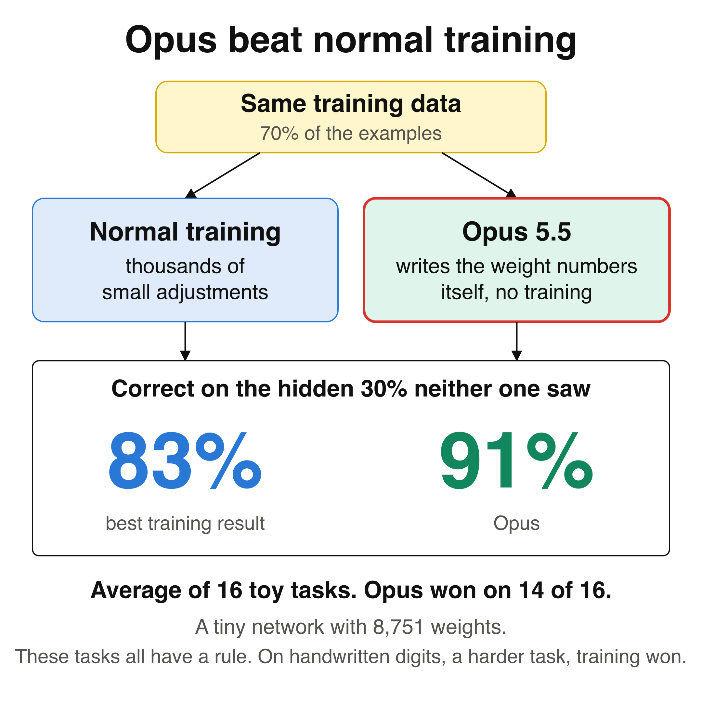
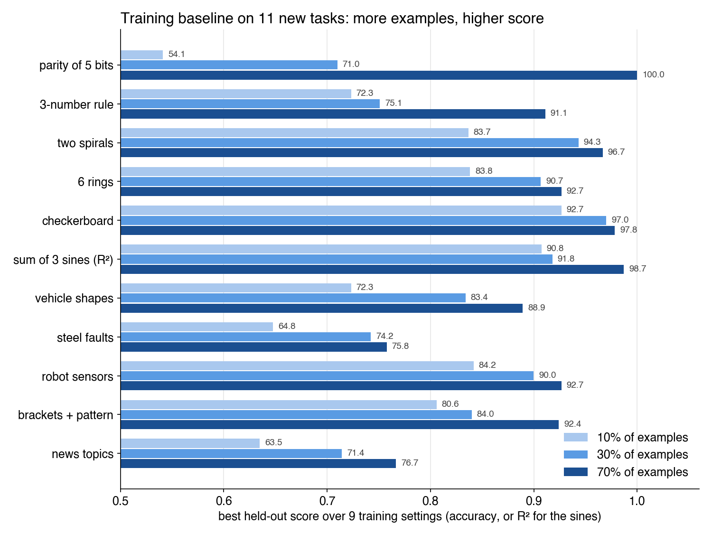
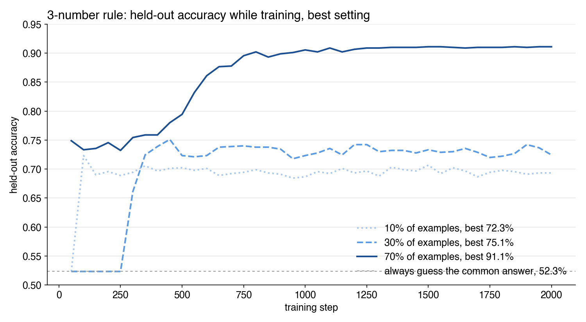
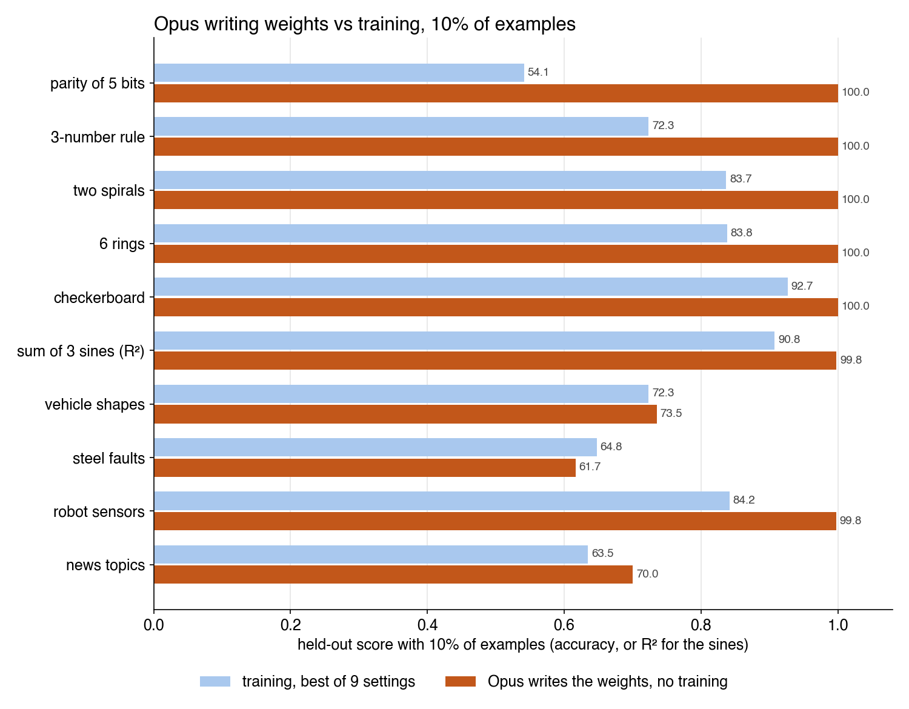

# What an LLM can and can't do by writing network weights

Claude Opus 5.5 read a task's training examples and wrote every weight of a small network as literal numbers, with no training. On 14 of 16 tasks that have a rule, those weights scored higher on unseen inputs than the best of 34 training settings (91.3% against 83.3%). On CIFAR-10, which has no short rule, training won (87.8% against 71.6%).

This repository asks why, and where the limits are. [QUESTIONS.md](QUESTIONS.md) lists 12 questions, each with a result whichever way it turns out. We are using this to write a paper for ICML 2027.



The full setup for the paper (tasks, data, networks, training baseline, LLM editor rules and score) is on the [setup page](https://vcn2lh6dzewa.feishu.cn/wiki/KXwSw6DwgioZJhkh5RKcZGE6n6g).

## Training baseline on 11 new tasks

The paper adds 11 tasks to the synthetic tables: synthetic tasks with other inputs, 3 real tables from OpenML, two sequence tasks and short news topics. Each task holds out a fixed 30% of its examples. Training sees 10%, 30% or 70% of them, and the smaller amounts are part of the larger ones. Each score is the best held-out score over 9 settings (learning rate .001, .003 or .01; weight decay 0, .01 or .1) at any step up to 2,000.



Every task scores higher with more examples, so each amount of data leaves room for the LLM to beat training. Parity, spirals, circles and the sines were made harder for this, because the first versions already scored 99% or more with 10% of examples. Parity now uses 5 hidden bits instead of 3. The spirals turn 3.5 times instead of 1.5. The circle task now has 6 rings instead of 1 circle. The sine frequencies are 10 to 25 instead of 1 to 6.



```bash
cd toy/suite
python3 data.py              # build every task and print its size
python3 baseline.py rule3 .1 # 9 settings on one task and amount, about 4 seconds
python3 chart.py             # redraw both charts from runs/baseline.jsonl
```

## Opus writes the weights on the new tasks, 10% of examples

A fresh Opus 5.5 saw only the training examples and the network's starting weights. It wrote every weight with numpy, with no training and no loop that fits weights to a loss. Then the written network was scored on the held-out 30%. It beat the best training setting on 9 of 10 tasks.



On the six synthetic tasks Opus found the exact hidden rule and built it into the weights, so it scored 99.8 to 100. On vehicles, steel and news topics it found no rule and wrote standard classifiers by hand (linear discriminants and naive Bayes), so the gains are small, and on steel it lost. The robot data was made by a fixed steering rule, which Opus may know from its training data. Every run's replies, code, written weights and audit are in `toy/suite/runs/opus/`. Three runs used one least-squares solve to read the data, which the earlier rules allow.

```bash
cd toy/suite
python3 bench.py test                 # checks every path in about 3 seconds
python3 bench.py new r1 rule3 .1      # make a run; the editor then uses only: python3 bench.py step r1 - <<'REPLY' ... REPLY
python3 bench.py audit r1 TRANSCRIPT  # a run counts only if every tool call was that command
python3 bench.py score r1             # held-out score next to the training baseline
python3 opus_chart.py                 # redraw charts/opus_10.png
```

## Setup

```bash
pip install -r requirements.txt
python3 -m venv toy/.kernel && toy/.kernel/bin/pip install numpy scipy
cd toy && python3 search.py test
```

The last command checks every path of the bench in about 5 seconds and ends with `ALL PASS`. The sandbox that runs the LLM's Python works on macOS; the Linux path exists and has not been tested.

## Files

| File | What it does |
|---|---|
| `toy/net.py` | The network: two numbers go in, one of 8 classes comes out, 8,751 weights. |
| `toy/search.py` | The main bench. Makes a task, lets an LLM change the weights before, during, after or instead of training, and compares it with 34 training settings. |
| `toy/bigger.py` | The same on MNIST and CIFAR-10 with a larger network. |
| `toy/digits.py` | The same on small handwritten digits. |
| `toy/steps_saved.py` | How many training steps an edit saves. |
| `toy/read_rule.py`, `toy/cocluster.py`, `toy/data_gone.py` | Plain scripts with no LLM, as rivals. |
| `toy/suite/` | The 11 new tasks: `data.py` (tasks), `nets.py` (networks), `baseline.py` (training baseline), `chart.py`, and every baseline run in `runs/baseline.jsonl`. `bench.py` is the Opus bench for these tasks, with every Opus run in `runs/opus/`. `compare/` holds the trained and the Opus-written network for each task, with a question to compare them. |
| `toy/search_runs/` | All 51 earlier Opus runs: the code each one wrote, what it got back, and its audit. |
| [RESULTS.md](RESULTS.md) | Every earlier table, the commands, and how to run an LLM as the editor. |
| [NOTES.md](NOTES.md) | The working log, with every rule and prediction written before each test. |

The licence is MIT.
